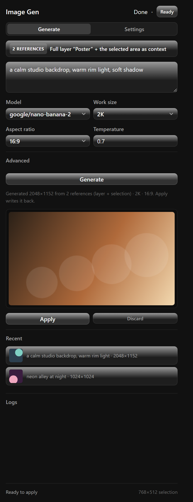
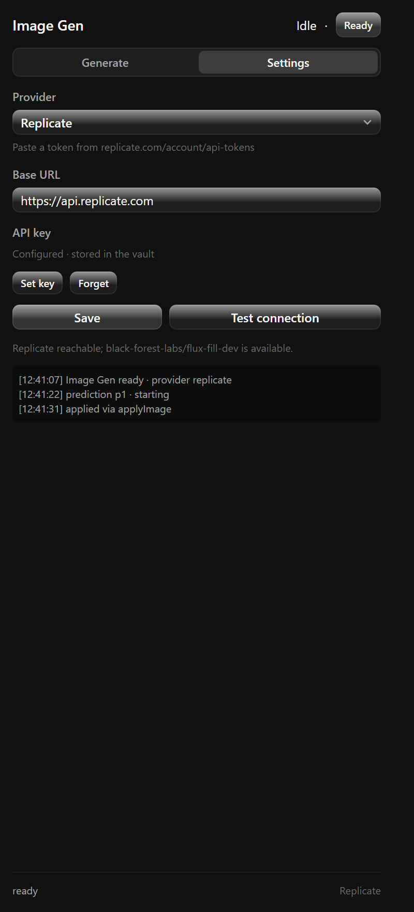

# Image Gen — Photon Studio plugin

Selection-aware generative image / inpainting for Photon Studio, powered by **Replicate** or any
**custom HTTP endpoint**. Make a selection in Photon, describe what belongs there, and the result is
written back **only inside the selection** as one undoable step.

| Generate | Settings |
| --- | --- |
|  |  |

## Install

1. Photon Studio → **Preferences → Plug-ins → Install plugin** → select this repository's
   `plugin/` folder.
2. Open the panel with **Plugins → Image Gen…** (`Ctrl+Shift+G`).
3. In **Settings**, pick a provider, store the API key, then **Test connection**.
4. Back in **Generate**, make a selection (optional), write a prompt and press **Generate**, then
   **Apply**.

## How selection editing works

Photon exposes the current selection to plugins only as a boolean, so the plugin uses the SDK's
capture API:

1. `documents.capture()` snapshots the selected area (pixels + bounds + selection coverage) and
   returns a `token`.
2. The captured pixels become the provider's base image; the coverage becomes the inpainting mask
   (white = generate here).
3. The returned image is sent back with
   `documents.applyImage({ image, captureToken })`, so Photon composites it through the real
   selection coverage — feathered edges included — in one undo step.
4. If the capture API is unavailable, the plugin still generates from the selected layer and writes
   the result as a new layer with the mask applied to its alpha (masked fallback).

Without a selection the whole selected layer becomes the source and the result lands as a new layer
aligned to the layer's bounds.

## Providers

### Replicate

- Model field accepts `owner/name` (official models) or `owner/name:version` (pinned community
  version).
- Submit uses `Prefer: wait=60`, then polls `GET /v1/predictions/{id}` every 1.5 s (max 180 s); the
  output URL is downloaded as bytes.
- Suggested models: `black-forest-labs/flux-fill-dev` (inpainting),
  `black-forest-labs/flux-dev` (image to image), `stability-ai/stable-diffusion-inpainting`.
- The API key is stored in Photon's credential vault and sent as `Authorization: Bearer …`; it is
  never written to plugin settings or logs.

### Custom endpoint

Any JSON endpoint that returns an image URL or base64 payload:

| Field | Meaning |
| --- | --- |
| Submit URL / Method | Where the request goes |
| Mode | `Image in the response` or `Poll until ready` |
| Headers template | Extra JSON headers (the API key can be attached as a credential) |
| Body template | JSON with `{{prompt}}`, `{{image}}`, `{{mask}}`, `{{width}}`, `{{height}}`, `{{seed}}`, `{{model}}` |
| Poll URL | e.g. `https://host/jobs/{{id}}` (poll mode) |
| Output path | Dot path to the image in the response, e.g. `data[0].url` or `output` |
| Status path / Success values | e.g. `status` + `succeeded,completed` |
| Image value | Data URI, bare base64, or URL |

Placeholders are JSON-escaped, so prompts with quotes cannot break the template.

## Controls

| Control | Range | Meaning |
| --- | --- | --- |
| Prompt | up to 2 000 chars | What to generate inside the selection |
| Model | text | `owner/name[:version]` for Replicate, free text for custom |
| Work size | Auto / 512 / 768 / 1024 / 1536 | Size sent to the provider; the result is scaled back to the selection |
| Steps / Guidance | — | Passed to providers that support them |
| Seed | empty = random | Reproducibility |
| Margin (px) | 0–256 | Grows the capture rectangle around the selection for context |
| Strength | 0.1–1 | Image-to-image strength where supported |

The panel keeps the last six results (prompt, size, thumbnail) for quick reuse.

## Limits and failure modes

- There is no brush-mask editor in this version: masks come from the Photon selection, or from the
  whole captured rectangle when the host does not expose the coverage.
- Work size is capped by the plugin transfer limits (8 192 px per side, 16 MP); larger work is
  scaled down before sending and the result is scaled back on apply.
- Generation needs network access to the provider's origin; the custom endpoint origin is allowed at
  save time and Replicate origins are declared in the manifest.
- A running generation can be cancelled; the capture token is released on discard.
- If the document changes while a prediction runs, Apply refuses instead of overwriting: generate
  again.
- Provider errors are translated (bad key, quota, rate limit, offline); nothing is retried
  automatically to avoid double billing.

## Verification status

- **Tested headless:** 44 tests (`core`, `providers`, `pipeline`) with a fake Photon SDK covering the
  capture → submit → poll → download → apply sequence, the masked fallback, cancellation, failed
  predictions and template parsing.
- **Not yet exercised against live Photon/Replicate in this repository.** The SDK behaviour above was
  read from Photon 0.1.66's `app.asar` (capture returns bounds/coverage and applyImage composites
  with the capture token), but a real generation round trip still needs a manual check.

```powershell
node tools/core-test.cjs        # 16 tests: masks, bounds, sizes, templates, parsing
node tools/providers-test.cjs   # 15 tests: Replicate and custom adapters
node tools/pipeline-test.cjs    # 12 tests: full flow with a fake SDK
node tools/bench.cjs            # mask/size timings and provider payload sizes
```

## Changelog

### 0.1.2

- **Body decoding accepts every shape Photon may hand back**: `Uint8Array`, `ArrayBuffer`, a typed
  view, or already-decoded text. A text body was being turned into zero bytes, which is why the
  prediction id came back empty.
- A submit without an id now reports the real response in the message
  (`HTTP <status> <content-type> · <body>` + the parsed JSON), and the panel log records each submit,
  so the next failure is diagnosable without guessing.
- Tests: 47.

### 0.1.1

- **Fixed "Polling failed (HTTP 404)".** Photon's `network.request` answers with
  `{ status, body: Uint8Array, headers }` — there is no `json` field, so the prediction id was read
  as `null` and the poll hit `/v1/predictions/null`. Responses are now decoded from the byte body
  (`readJson`), and a submit that returns no id fails with a clear message instead of polling `null`.
- Non-2xx responses now include a snippet of the provider's body in the error (that is where
  Replicate puts `{"detail": …}`).

### 0.1.0

- First release: Replicate + custom endpoint providers, selection-aware inpainting through
  `documents.capture` / `applyImage(captureToken)`, masked layer fallback, work-size planning,
  recent results, credential-vault API keys.

MIT licensed — see [LICENSE](LICENSE).
